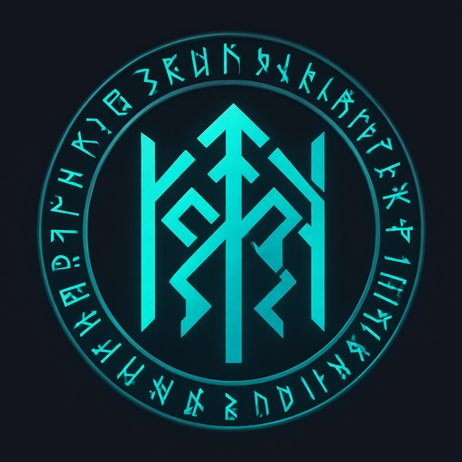

<p align="center"></p>

<h1 align="center">TAMGA</h1>

<p align="center">
  <i>The seal that unites your Linux packages</i><br>
  <i>Le sceau qui unit vos paquets Linux</i><br>
  <i>Linux paketlerinizi birleştiren mühür</i>
</p>

<p align="center">
  
  
  
  
</p>

<p align="center">
  <a href="#english">🇬🇧 English</a> ·
  <a href="#francais">🇫🇷 Français</a> ·
  <a href="#turkce">🇹🇷 Türkçe</a>
</p>

<p align="center">
  🇹🇷 Türkçe · 🇫🇷 Français · 🇬🇧 English · 🇸🇦 العربية · 🇮🇹 Italiano · 🇵🇹 Português · 🇪🇸 Español
</p>

---

<a id="english"></a>

## 🇬🇧 English

Smart Linux package converter: **.deb ↔ .rpm ↔ Arch (.pkg) ↔ .sh**, with dependency
translation for each distribution.

### What TAMGA does

| From ↓ / To → | .deb | .rpm | Arch (.pkg.tar.zst) | .sh |
|---|:---:|:---:|:---:|:---:|
| **.deb** (Debian, Ubuntu, Mint…) | — | ✅ | ✅ | ✅ |
| **.rpm** (Fedora, RHEL, openSUSE…) | ✅ | — | ✅ | ✅ |
| **Arch** (.pkg.tar.zst, .pacman) | ✅ | ✅ | — | ✅ |
| **.sh** made by TAMGA | ✅ | ✅ | ✅ | — |

- **Faithful conversion**: permissions, owners, symbolic links and configuration files are preserved.
- **Dependencies translated** for the target distribution: TAMGA reads the libraries the programs
  really use (ELF analysis), asks the local system (is the package installed? available in the
  repositories?), then uses its correspondence tables and, optionally, Repology.
- **Self-contained .sh installer**: checks the architecture, glibc and libraries, suggests the right
  install command (apt, dnf, zypper, pacman), backs up replaced files and provides an uninstaller.
- **Original install scripts** adapted to the target format (advanced option, off by default).
- **100% Rust engine**: no need for dpkg, rpmbuild or makepkg to convert.
- **Command-line mode**: `tamga convert package.deb --to rpm` (see `tamga --help-cli`).

### Install TAMGA

Download the installation files from the
[**Releases**](https://github.com/davidharputoglu/tamga/releases) page:

| File | For | Command |
|---|---|---|
| `TAMGA-0.1-1.x86_64.rpm` | Fedora, RHEL, openSUSE | `sudo dnf install ./TAMGA-0.1-1.x86_64.rpm` |
| `TAMGA_0.1_amd64.deb` | Debian, Ubuntu, Mint | `sudo apt install ./TAMGA_0.1_amd64.deb` |
| `TAMGA_0.1_amd64.AppImage` | all distributions | `chmod +x TAMGA_0.1_amd64.AppImage && ./TAMGA_0.1_amd64.AppImage` |
| `tamga-0.1-x86_64.sh` | all distributions | `sh tamga-0.1-x86_64.sh` |
| `tamga-0.1-source.tar.gz` | source code | see “Build TAMGA” below |

The versions published on GitHub need glibc 2.35 or newer
(Debian 12, Ubuntu 22.04, Linux Mint 21, Fedora 36+, openSUSE, Arch…).

### How the installation files are built

GitHub builds them automatically (file `.github/workflows/installateurs.yml`):

1. **Actions** tab → **Installateurs TAMGA** → **Run workflow** button;
2. or by pushing a version tag: `git tag v0.1 && git push origin v0.1`.

A few minutes later, a new Release appears with the .deb, the .rpm, the AppImage, the .sh
(made by TAMGA itself from the .deb), the source code archive and `SHA256SUMS.txt`.
You can produce the same files on your own computer with `npm run build` (see below).

### Build TAMGA

**Fedora**
```bash
sudo dnf install webkit2gtk4.1-devel openssl-devel curl wget file \
    libappindicator-gtk3-devel librsvg2-devel libxdo-devel nodejs npm
sudo dnf group install development-tools
curl --proto '=https' --tlsv1.2 -sSf https://sh.rustup.rs | sh
```

**Debian / Ubuntu**
```bash
sudo apt install libwebkit2gtk-4.1-dev build-essential curl wget file \
    libxdo-dev libssl-dev libayatana-appindicator3-dev librsvg2-dev nodejs npm
curl --proto '=https' --tlsv1.2 -sSf https://sh.rustup.rs | sh
```

**Then, in the project folder**
```bash
npm install          # installs the Tauri tool
npm run dev          # starts TAMGA in development mode
npm run build        # builds the installers in src-tauri/target/release/bundle/
```

Engine tests: `cd core && cargo test`.

### Code layout

```
core/          conversion engine (Rust, no interface) + tamga-cli tool
  src/deb.rs, rpm.rs, pacman.rs, shell.rs   reading/writing each format
  src/deps.rs, mapping.rs, distro.rs        dependency translation
src-tauri/     desktop application (bridge between the interface and the engine)
src/           interface (HTML, CSS, JavaScript) and translations (locales/)
assets/        original logo
```

### License

MIT — see [LICENSE](LICENSE) · Disclaimer: [DISCLAIMER.md](DISCLAIMER.md) ·
Privacy: [PRIVACY.md](PRIVACY.md) (these two documents are in French).

---

<a id="francais"></a>

## 🇫🇷 Français

Convertisseur intelligent de paquets Linux : **.deb ↔ .rpm ↔ Arch (.pkg) ↔ .sh**, avec
traduction des dépendances pour chaque distribution.

### Ce que fait TAMGA

| De ↓ / vers → | .deb | .rpm | Arch (.pkg.tar.zst) | .sh |
|---|:---:|:---:|:---:|:---:|
| **.deb** (Debian, Ubuntu, Mint…) | — | ✅ | ✅ | ✅ |
| **.rpm** (Fedora, RHEL, openSUSE…) | ✅ | — | ✅ | ✅ |
| **Arch** (.pkg.tar.zst, .pacman) | ✅ | ✅ | — | ✅ |
| **.sh** créé par TAMGA | ✅ | ✅ | ✅ | — |

- **Conversion fidèle** : droits, propriétaires, liens symboliques et fichiers de configuration sont conservés.
- **Dépendances traduites** pour la distribution cible : TAMGA lit les bibliothèques réellement
  utilisées par les programmes (analyse ELF), interroge le système local (paquet installé ?
  disponible dans les dépôts ?), puis ses tables de correspondance, et en option Repology.
- **Installateur .sh autonome** : vérifie l'architecture, la glibc et les bibliothèques, propose la
  commande d'installation adaptée (apt, dnf, zypper, pacman), garde une sauvegarde des fichiers
  remplacés et fournit un désinstallateur.
- **Scripts d'installation** d'origine adaptés au format cible (option avancée, désactivée par défaut).
- **Moteur 100 % Rust** : aucun besoin de dpkg, rpmbuild ou makepkg pour convertir.
- **Mode texte** : `tamga convert paquet.deb --to rpm` (voir `tamga --help-cli`).

### Installer TAMGA

Les fichiers d'installation se téléchargent sur la page
[**Releases**](https://github.com/davidharputoglu/tamga/releases) du dépôt :

| Fichier | Pour | Commande |
|---|---|---|
| `TAMGA-0.1-1.x86_64.rpm` | Fedora, RHEL, openSUSE | `sudo dnf install ./TAMGA-0.1-1.x86_64.rpm` |
| `TAMGA_0.1_amd64.deb` | Debian, Ubuntu, Mint | `sudo apt install ./TAMGA_0.1_amd64.deb` |
| `TAMGA_0.1_amd64.AppImage` | toutes distributions | `chmod +x TAMGA_0.1_amd64.AppImage && ./TAMGA_0.1_amd64.AppImage` |
| `tamga-0.1-x86_64.sh` | toutes distributions | `sh tamga-0.1-x86_64.sh` |
| `tamga-0.1-source.tar.gz` | code source | voir « Compiler TAMGA » ci-dessous |

Les versions publiées sur GitHub demandent une glibc 2.35 ou plus récente
(Debian 12, Ubuntu 22.04, Linux Mint 21, Fedora 36+, openSUSE, Arch…).

### Comment ces fichiers sont construits

GitHub les fabrique automatiquement (fichier `.github/workflows/installateurs.yml`) :

1. onglet **Actions** → **Installateurs TAMGA** → bouton **Run workflow** ;
2. ou en poussant une étiquette de version : `git tag v0.1 && git push origin v0.1`.

Quelques minutes plus tard, une nouvelle Release apparaît avec le .deb, le .rpm, l'AppImage,
le .sh (fabriqué par TAMGA lui-même à partir du .deb), l'archive du code source et
le fichier `SHA256SUMS.txt`. Les mêmes fichiers peuvent être produits sur votre machine
avec `npm run build` (voir ci-dessous).

### Compiler TAMGA

**Fedora**
```bash
sudo dnf install webkit2gtk4.1-devel openssl-devel curl wget file \
    libappindicator-gtk3-devel librsvg2-devel libxdo-devel nodejs npm
sudo dnf group install development-tools
curl --proto '=https' --tlsv1.2 -sSf https://sh.rustup.rs | sh
```

**Debian / Ubuntu**
```bash
sudo apt install libwebkit2gtk-4.1-dev build-essential curl wget file \
    libxdo-dev libssl-dev libayatana-appindicator3-dev librsvg2-dev nodejs npm
curl --proto '=https' --tlsv1.2 -sSf https://sh.rustup.rs | sh
```

**Puis, dans le dossier du projet**
```bash
npm install          # installe l'outil Tauri
npm run dev          # lance TAMGA en mode développement
npm run build        # fabrique les installateurs dans src-tauri/target/release/bundle/
```

Tests du moteur : `cd core && cargo test`.

### Organisation du code

```
core/          moteur de conversion (Rust, sans interface) + outil tamga-cli
  src/deb.rs, rpm.rs, pacman.rs, shell.rs   lecture/écriture de chaque format
  src/deps.rs, mapping.rs, distro.rs        traduction des dépendances
src-tauri/     application de bureau (pont entre l'interface et le moteur)
src/           interface (HTML, CSS, JavaScript) et traductions (locales/)
assets/        logo d'origine
```

### Licence

MIT — voir [LICENSE](LICENSE) · Avertissement : [DISCLAIMER.md](DISCLAIMER.md) ·
Confidentialité : [PRIVACY.md](PRIVACY.md).

---

<a id="turkce"></a>

## 🇹🇷 Türkçe

Akıllı Linux paket dönüştürücü: **.deb ↔ .rpm ↔ Arch (.pkg) ↔ .sh**, her dağıtım için
bağımlılık çevirisiyle.

### TAMGA ne yapar?

| Kaynak ↓ / Hedef → | .deb | .rpm | Arch (.pkg.tar.zst) | .sh |
|---|:---:|:---:|:---:|:---:|
| **.deb** (Debian, Ubuntu, Mint…) | — | ✅ | ✅ | ✅ |
| **.rpm** (Fedora, RHEL, openSUSE…) | ✅ | — | ✅ | ✅ |
| **Arch** (.pkg.tar.zst, .pacman) | ✅ | ✅ | — | ✅ |
| TAMGA ile oluşturulmuş **.sh** | ✅ | ✅ | ✅ | — |

- **Aslına uygun dönüştürme**: izinler, dosya sahipleri, sembolik bağlantılar ve yapılandırma
  dosyaları korunur.
- **Hedef dağıtıma göre çevrilen bağımlılıklar**: TAMGA, programların gerçekten kullandığı
  kütüphaneleri okur (ELF analizi), yerel sistemi sorgular (paket kurulu mu? depolarda var mı?),
  ardından kendi eşleştirme tablolarına ve isteğe bağlı olarak Repology'ye başvurur.
- **Bağımsız .sh kurulum dosyası**: mimariyi, glibc sürümünü ve kütüphaneleri denetler, uygun
  kurulum komutunu önerir (apt, dnf, zypper, pacman), değiştirilen dosyaları yedekler ve bir
  kaldırma aracı sunar.
- **Orijinal kurulum betikleri** hedef biçime uyarlanır (gelişmiş seçenek, varsayılan olarak kapalı).
- **%100 Rust motoru**: dönüştürmek için dpkg, rpmbuild veya makepkg gerekmez.
- **Komut satırı modu**: `tamga convert paket.deb --to rpm` (bkz. `tamga --help-cli`).

### TAMGA'yı kurun

Kurulum dosyaları deponun [**Releases**](https://github.com/davidharputoglu/tamga/releases)
sayfasından indirilir:

| Dosya | Hangi sistem için | Komut |
|---|---|---|
| `TAMGA-0.1-1.x86_64.rpm` | Fedora, RHEL, openSUSE | `sudo dnf install ./TAMGA-0.1-1.x86_64.rpm` |
| `TAMGA_0.1_amd64.deb` | Debian, Ubuntu, Mint | `sudo apt install ./TAMGA_0.1_amd64.deb` |
| `TAMGA_0.1_amd64.AppImage` | tüm dağıtımlar | `chmod +x TAMGA_0.1_amd64.AppImage && ./TAMGA_0.1_amd64.AppImage` |
| `tamga-0.1-x86_64.sh` | tüm dağıtımlar | `sh tamga-0.1-x86_64.sh` |
| `tamga-0.1-source.tar.gz` | kaynak kod | aşağıdaki « TAMGA'yı derleme » bölümüne bakın |

GitHub'da yayımlanan sürümler glibc 2.35 veya daha yenisini gerektirir
(Debian 12, Ubuntu 22.04, Linux Mint 21, Fedora 36+, openSUSE, Arch…).

### Kurulum dosyaları nasıl oluşturulur?

GitHub bunları otomatik olarak oluşturur (`.github/workflows/installateurs.yml` dosyası):

1. **Actions** sekmesi → **Installateurs TAMGA** → **Run workflow** düğmesi;
2. ya da bir sürüm etiketi göndererek: `git tag v0.1 && git push origin v0.1`.

Birkaç dakika sonra .deb, .rpm, AppImage, .sh (TAMGA'nın kendisi tarafından .deb'den üretilir),
kaynak kod arşivi ve `SHA256SUMS.txt` dosyasını içeren yeni bir Release yayımlanır.
Aynı dosyaları kendi bilgisayarınızda `npm run build` ile de üretebilirsiniz (aşağıya bakın).

### TAMGA'yı derleme

**Fedora**
```bash
sudo dnf install webkit2gtk4.1-devel openssl-devel curl wget file \
    libappindicator-gtk3-devel librsvg2-devel libxdo-devel nodejs npm
sudo dnf group install development-tools
curl --proto '=https' --tlsv1.2 -sSf https://sh.rustup.rs | sh
```

**Debian / Ubuntu**
```bash
sudo apt install libwebkit2gtk-4.1-dev build-essential curl wget file \
    libxdo-dev libssl-dev libayatana-appindicator3-dev librsvg2-dev nodejs npm
curl --proto '=https' --tlsv1.2 -sSf https://sh.rustup.rs | sh
```

**Ardından, proje klasöründe**
```bash
npm install          # Tauri aracını kurar
npm run dev          # TAMGA'yı geliştirme modunda başlatır
npm run build        # kurulum dosyalarını src-tauri/target/release/bundle/ içinde üretir
```

Motor testleri: `cd core && cargo test`.

### Kod düzeni

```
core/          dönüştürme motoru (Rust, arayüzsüz) + tamga-cli aracı
  src/deb.rs, rpm.rs, pacman.rs, shell.rs   her biçimin okunması/yazılması
  src/deps.rs, mapping.rs, distro.rs        bağımlılık çevirisi
src-tauri/     masaüstü uygulaması (arayüz ile motor arasındaki köprü)
src/           arayüz (HTML, CSS, JavaScript) ve çeviriler (locales/)
assets/        orijinal logo
```

### Lisans

MIT — bkz. [LICENSE](LICENSE) · Sorumluluk reddi: [DISCLAIMER.md](DISCLAIMER.md) ·
Gizlilik: [PRIVACY.md](PRIVACY.md) (bu iki belge Fransızcadır).
